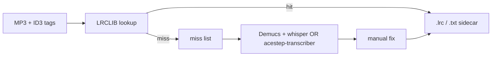

# Lyrics extraction

Host-only lyrics fetch for the music library. Phase 1 uses **LRCLIB** (free API, no key) — fast when ID3 tags match a known track. GPU transcription (Whisper, acestep-transcriber) is documented here for later.

Sidecars live next to each MP3 (same pattern as Essentia `.audio.yaml`). No lyrics are embedded in MP3 tags — keeps files small and makes “already done” trivial to detect.

## Setup

In `.env`:

```env
LYRICS_FETCH=1
MUSIC_DIR=/path/to/Music
```

No extra pip deps — uses `requests` (already in `requirements.txt`).

## Run

```bash
# Full library (skips sidecar or TXXX:LYRICS_LRCLIB=nomatch)
LYRICS_FETCH=1 ./scripts/fetch-lyrics.py

# Playlists
LYRICS_FETCH=1 ./scripts/fetch-lyrics.py "Sing Along" Epic

# Single file or folder
LYRICS_FETCH=1 ./scripts/fetch-lyrics.py "Sing Along/Pretenders - I'll Stand by You.mp3"

# Re-fetch (clears nomatch tag)
LYRICS_FETCH=1 ./scripts/fetch-lyrics.py --force
```

**Pi over SSHFS** (Essentia on GPU, lyrics fetch in parallel — no GPU):

```bash
MUSIC_DIR=~/Code/pi/ssd/Music LYRICS_FETCH=1 ./scripts/fetch-lyrics.py
```

Skip detection (unless `--force`):

1. `.lrc` or `.txt` sidecar exists
2. ID3 `TXXX:LYRICS_LRCLIB` = `nomatch` (written on LRCLIB miss)
3. Missing `TIT2`/`TPE1` tags — skipped, **not** tagged (fix tags to retry)

---

## Sidecar formats

| File | When written | Navidrome | ACE-Step |
|------|--------------|-----------|----------|
| `Artist - Title.lrc` | LRCLIB returns synced lyrics | Yes (Subsonic clients) | Strip timestamps → `.lyrics.txt` |
| `Artist - Title.txt` | LRCLIB returns plain lyrics only | Yes | Rename/copy → `.lyrics.txt` |

### ACE-Step transform (no extra tools)

ACE-Step training expects `song.lyrics.txt` beside `song.mp3`.

From **synced** sidecar:

```bash
python -c "
import re, sys
from pathlib import Path
mp3 = Path(sys.argv[1])
lrc = mp3.with_suffix('.lrc')
out = mp3.with_name(mp3.stem + '.lyrics.txt')
lines = []
for raw in lrc.read_text().splitlines():
    line = re.sub(r'\[\d{1,2}:\d{2}(?:\.\d{1,3})?\]', '', raw).strip()
    if line and not line.startswith('['):
        lines.append(line)
out.write_text('\n'.join(lines) + '\n')
" "Artist - Title.mp3"
```

From **plain** sidecar:

```bash
cp "Artist - Title.txt" "Artist - Title.lyrics.txt"
```

`lyrics.lrc_to_plain()` in `lyrics.py` does the LRC strip if you need it in Python.

Structural tags (`[Verse]`, `[Chorus]`) are optional for ACE-Step — add manually or via a future transcription pass.

---

## Navidrome (Pi)

Navidrome (`deluan/navidrome:latest`) reads lyrics from:

**Sidecar** (same folder, same basename as MP3):

| Extension | Content |
|-----------|---------|
| `.lrc` | Synced (preferred) |
| `.elrc` | Word-level synced |
| `.srt` | Subtitle-style |
| `.ttml` | TTML |
| `.yaml` / `.yml` | Lyricsfile format |
| `.txt` | Plain unsynced |

Default priority: `.ttml,.yaml,.yml,.elrc,.lrc,.srt,.txt,embedded`

**Embedded ID3** (we do *not* write these by default):

| Frame | Content |
|-------|---------|
| `USLT` | Unsynced |
| `SYLT` | Synced |

**Web UI caveat:** the built-in Navidrome player only shows **embedded** lyrics. Sidecar `.lrc` files are served via OpenSubsonic to clients like **Feishin** and **Symfonium**. After fetch, trigger a library scan (`.rescan` touch or Navidrome UI).

Optional later: embed `USLT` from sidecar content for web UI — mutagen can do this without re-encoding audio.

---

## Phase 1: LRCLIB lookup (implemented)

**How it works**

1. Read `TIT2` (title), `TPE1` (artist), `TALB` (album), duration from MP3.
2. `GET https://lrclib.net/api/get` with exact signature (duration must match ±2s).
3. On 404, `GET /api/search` and pick best duration match.
4. Write `.lrc` if `syncedLyrics` present, else `.txt` if `plainLyrics` present.
5. Skip instrumentals (`instrumental: true`).
6. On miss, write `TXXX:LYRICS_LRCLIB=nomatch` into the MP3 (same pattern as `SPOTIFY_ID`).
7. Hard-link sidecar to duplicate MP3 paths (same inode groups as Essentia).

**Pros:** Free, no GPU, correct lyrics for commercial tracks, synced LRC when available.

**Cons:** Misses obscure/live/bootleg versions, wrong duration, covers with different timing.

**Requirements:** ID3 tags must be set (spotify-to-mp3 downloader does this).

---

## Phase 2+ options (not implemented)

### Tier comparison

| Approach | Quality (singing) | GPU | Format output | Status |
|----------|-------------------|-----|---------------|--------|
| **LRCLIB lookup** | Excellent (known songs) | None | `.lrc` / `.txt` | **Implemented** |
| Demucs + faster-whisper | Good draft | 4070, ~6GB | Plain `.txt` | Planned fallback |
| acestep-transcriber | Best for ACE-Step | 11B — tight on 8GB | `[Verse]` tags | Planned |
| Plain Whisper on MP3 | Mediocre | 4070 | Plain `.txt` | Skip |
| Cloud APIs (ElevenLabs, etc.) | Good | None | LRC/JSON | Optional |
| Embed USLT in MP3 | N/A | None | Embedded | Optional later |

### acestep-transcriber (ACE-Step native)

Model: [ACE-Step/acestep-transcriber](https://huggingface.co/ACE-Step/acestep-transcriber) — 11B, Qwen2.5-Omni–based, outputs structure tags (`[Verse 1]`, `[Chorus]`, etc.).

**Quants on 8GB RTX 4070:**

| Variant | Linux CUDA ready? | Fits 8GB? |
|---------|-------------------|-----------|
| Official BF16 | Yes (transformers) | No (~22GB+ weights) |
| Official GGUF | No (GGUF repo is music *gen*, not transcriber) | — |
| Community 4-bit MLX (`DaRealDahoodie/pimp-audio-ace-transcriber-4bit-v1`) | **Mac/MLX only** | Recommends 32GB unified |
| DIY bitsandbytes 4-bit + CPU offload | Possible, untested | Maybe for short tracks |
| Colab T4 (16GB) | Yes | Safer for batch |

Qwen2.5-Omni GPTQ-Int4 uses ~11.6GB VRAM for 15s of audio — full songs on 8GB are risky. Your Qwen 14B Q3 experience doesn’t directly transfer (audio encoder + activations over track length).

**When to use:** Small curated sets for ACE-Step LoRA training where structure tags matter. Run on Colab or experiment with 4-bit offload after LRCLIB misses are known.

### Demucs + faster-whisper (local fallback)

```
MP3 → htdemucs vocals stem → faster-whisper large-v3-turbo-int8 → .txt
```

Reuse model from `~/Code/dictation/downloads/large-v3-turbo-int8/`. Better than raw Whisper on full mixes. Manual cleanup still required.

**GPU sharing:** don’t run alongside Essentia on 8GB (`ESSENTIA_CPU=1` or run lyrics fetch while Essentia runs — LRCLIB uses no GPU).

### Cloud / paid

ACE-Step ships API scripts for OpenAI Whisper and ElevenLabs Scribe. Good quality, unnecessary if local GPU + LRCLIB cover most of the library.

---

## Pipeline sketch (future)



---

## Files

| Path | Role |
|------|------|
| `lyrics.py` | LRCLIB client, sidecar I/O, nomatch TXXX tag, library batch |
| `scripts/fetch-lyrics.py` | CLI — library, playlists, or individual paths |

## Related

- [essentia.md](essentia.md) — audio analysis sidecars (`.audio.yaml`)
- [snippets.md](snippets.md) — copy-paste commands
- ACE-Step LoRA docs — `song.lyrics.txt` training format
